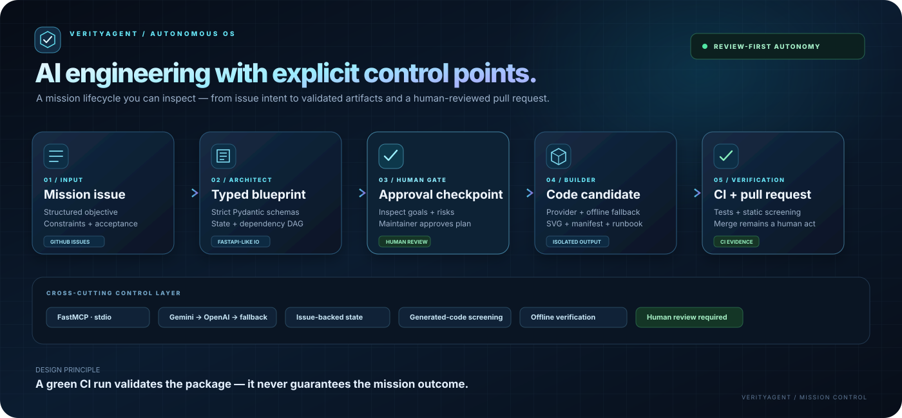

# VerityAgent Autonomous OS

**A GitHub-native mission operating system for planning, building, verifying, and reviewing AI-assisted engineering work.**

VerityAgent Autonomous OS converts a structured GitHub Issue into a validated mission blueprint, persists auditable state, generates a reviewable implementation candidate, verifies the package, and opens a pull request for human review. GitHub Actions is the execution plane; GitHub Issues provide the human state machine; GitHub Pages can serve the zero-build command center from the repository's docs folder.

> **Engineering contract:** CI can verify schemas, syntax, the trusted inspection runner, and the offline pipeline. It does not prove that generated domain logic is correct or that a requested business outcome has happened. Model-generated source is not executed by CI, merged, or deployed automatically.

## Visual command center

The redesigned [command center source](docs/index.html) is a responsive, dependency-free operations dashboard with an animated mission-network hero, clickable SVG execution graph, state-derived completion ring and per-stage chart, an animated lifecycle infographic with replay control, artifact registry, and compact platform architecture panels. It honors reduced-motion preferences and displays a preview state until a mission snapshot is published. The visual architecture below is also available as a standalone SVG infographic.

To publish the dashboard as a site, open repository Settings → Pages, choose Deploy from a branch, select <code>main</code> and <code>/docs</code>, and save.

| Layer | Responsibility |
|---|---|
| Mission intake | A structured Issue captures objective, requirements, acceptance criteria, and constraints. |
| Architect | Validates inputs, creates a Pydantic blueprint, writes issue-scoped state, and publishes a dependency DAG. |
| Human gate | A maintainer reviews the blueprint and applies the **approved** label. |
| Builder | Produces a **mission_solution.py** candidate, validation report, inspection runner, JSON manifest, SVG dependency map, dependency-wave schedule, SHA-256 artifact ledger, and package guide. |
| Verification | Pytest, Python compilation, manifest checks, YAML parsing, and MCP stdio handshake tests verify the core pipeline. |
| Command center | docs/index.html renders state from docs/state.json without a frontend build step. |
| Model routing | Gemini, then OpenAI, then deterministic fallback; offline mode makes no network calls. |

## Fast start

Requires Python 3.11 or newer and [uv](https://docs.astral.sh/uv/).

<pre><code>git clone https://github.com/muhammadsaeed-ai/verity-autonomous-os.git
cd verity-autonomous-os
uv sync --group dev
uv run pytest -q</code></pre>

Run the deterministic pipeline locally. These commands require no API key and do not contact external LLM providers.

<pre><code>uv run verity-architect --issue-number 0 --title "Internal reporting mission" --body "Generate a reviewable reporting package." --output-dir /tmp/verity-artifacts --state-path /tmp/verity-state.json --dry-run
uv run verity-builder --issue-number 0 --output-dir /tmp/verity-artifacts --state-path /tmp/verity-state.json --dry-run</code></pre>

The Builder writes these files under the mission-specific output directory:

- **mission_solution.py** — a provider-generated local implementation candidate, or a deterministic contract implementation when offline or no LLM key is available.
- **generator.json** — provider, syntax-check, safety-check, and fallback metadata.
- **mission_runner.py** — a trusted inspection utility that produces a manifest and does not execute the implementation candidate.
- **architecture.svg**, **mission.json**, and **README.md** — the visual DAG, validated mission contract, and package documentation.
- **mission_schedule.json** — deterministic topological waves, estimated critical path, ready set, dependency-edge count, and theoretical parallelism metrics. These are plan estimates; they do not execute tasks concurrently.
- **mission_readiness.json** — deterministic mission readiness score with rule-coded blockers, warnings, and review recommendations.
- **verification_report.json** — machine-readable checks and an explicit record that generated candidate execution was intentionally skipped.
- **artifact_manifest.json** — SHA-256 digests, sizes, and a canonical ledger seal for the blueprint and generated package files.

Generated source is syntax-checked and screened by a restricted AST policy. Static analysis is defense-in-depth, not a sandbox or proof of security/correctness; candidates are not executed by CI. Review the candidate, add mission-specific tests, and use an appropriately isolated environment before any manual execution.

## Model providers

Set the environment variables in your shell or configure repository secrets. Never commit API keys.

| Priority | Environment variable | Behavior |
|---|---|---|
| 1 | GEMINI_API_KEY | Uses Gemini generate-content when configured. |
| 2 | OPENAI_API_KEY | Tries OpenAI Chat Completions if Gemini is absent or fails. |
| 3 | No key required | Uses deterministic, repeatable planning and candidate generation, suitable for CI and offline checks. |

Set VERITY_OFFLINE=1 to guarantee no provider network call. Set VERITY_STRICT_LLM=1 to raise when a configured provider fails rather than falling back. CrewAI can orchestrate the planning phase when the optional extra and a provider key are available:

<pre><code>uv sync --extra agency --group dev
export VERITY_USE_CREWAI=1</code></pre>

Implementation source generation uses the direct Gemini/OpenAI provider path so its output can be statically validated. Core schemas, state transitions, verification, and fallback generation do not depend on CrewAI being available.

## GitHub-native operating procedure

1. Open an issue using the **New VerityAgent Mission** form. For cost and write-permission safety, merely opening a public issue does not trigger the privileged planning job unless the author is the owner, a member, or a collaborator. The repository owner can explicitly authorize an outside request by applying **new-project**.
2. Workflow 01 ensures the **new-project**, **approved**, and **blueprint-ready** labels exist, then commits blueprint.json, blueprint.md, and issue-specific state. It comments with the blueprint and applies blueprint-ready.
3. Review the blueprint and acceptance criteria. Apply approved only after the plan is acceptable.
4. Workflow 02 runs only after a trusted mission author or the repository owner authorizes the **approved** label. It builds a bounded artifact package, applies static checks without executing generated source, runs compilation and tests, and opens a mission-specific pull request.
5. Review the generated package, add mission-specific tests, and merge manually only after your checks pass.

Workflow 03 runs scheduled maintenance checks and opens an issue on failure. Workflow 04 runs on pushes, pull requests, and manual dispatch. GEMINI_API_KEY and OPENAI_API_KEY are optional repository secrets; deterministic checks do not need them.

## Command center / GitHub Pages

The interactive, responsive dashboard is in docs/index.html; its companion state is docs/state.json, and its architecture artwork is docs/assets/architecture.svg. The page reads the JSON beside it and has a built-in preview fallback.

To publish it through GitHub Pages, open **Repository Settings → Pages**, select **Deploy from a branch**, choose **main** and **/docs**, and save. The source files are committed; publishing is a repository setting and must be enabled by a repository administrator.

## FastMCP tools and resources

Start the server over stdio:

<pre><code>uv run verity-mcp</code></pre>

Tools:
- mission_validate — validate bounded mission fields and acceptance criteria.
- public_api_search — query the local registry of unauthenticated public API examples.
- mission_blueprint — create a validated deterministic blueprint.
- mission_state — read repository-local state while rejecting path traversal.
- svg_architecture_spec — create an SVG flow preview from node names.
- mission_schedule — validate and analyze a bounded dependency graph, returning deterministic parallel waves and critical-path metrics.
- mission_frontier — identify runnable nodes, waiting dependencies, propagated blockers, and terminal mission state.
- mission_readiness — assess scope, acceptance criteria, dependency integrity, constraints, and risks with deterministic review findings.
- mission_artifact_integrity — verify a locally generated mission’s SHA-256 artifact ledger without executing generated files.

Resources:
- vault://system-design
- vault://12-factor

The tool surface is deliberately narrow. It does not expose arbitrary shell execution, direct file writes, deployment, or an unrestricted network proxy.

## Repository map

<pre><code>.github/
  ISSUE_TEMPLATE/new_mission.yml
  workflows/
    01_architect_plan.yml
    02_execute_build.yml
    03_daily_auto_agent.yml
    04_ci_verification.yml
knowledge_vault/
  system_design_rules.md
  12_factor_rules.md
  public_apis_min.json
mcp_and_crews/
  mission_engine.py
  schemas.py
  llm_factory.py
  code_generator.py
  mcp_stdio_server.py
  run_architect.py
  run_builder.py
generated_artifacts/
  .gitkeep
docs/
  index.html
  state.json
  assets/architecture.svg
tests/
  test_knowledge_vault.py
  test_mcp_server.py
  test_pipeline_e2e.py
  test_code_generator.py
  test_llm_factory.py
  test_schemas.py
pyproject.toml
.env.example</code></pre>

## Verification model

The CI suite checks the public API registry, knowledge base, issue form and workflow YAML, dashboard JSON, nine MCP tools, repository path restrictions, SVG escaping, and a real stdio initialize/tools-list handshake. It also runs Architect → Builder end-to-end in deterministic mode, tests the generated-code screening rules and provider-error redaction, verifies privileged workflow authorization and immutable action pins, exercises deterministic DAG scheduling, live dependency-frontier resolution, mission-readiness assessments, detects artifact tampering and path traversal, verifies the MCP tool surface, compiles generated Python, and executes only the trusted inspection runner.

The latest hosted GitHub Actions result is the source of truth for a commit. A successful pipeline means package generation and verification passed; it does not certify external API uptime or mission-specific production logic.

## Security and operational boundaries

- Issue text, model output, tool results, and API responses are untrusted data.
- Generated mission output stays under the issue-scoped generated_artifacts/missions directory.
- The Builder does not run issue-supplied shell commands or edit workflows.
- Provider failures are recorded as warnings unless strict mode is enabled.
- State does not contain provider credentials.
- Pull-request review remains the promotion boundary. There is no automatic deployment or self-merge.

## Built by VerityAgent

VerityAgent builds practical AI agents and automation systems. This repository focuses on making agent-assisted engineering auditable, testable, and review-first rather than hiding work behind an opaque autonomous loop.
